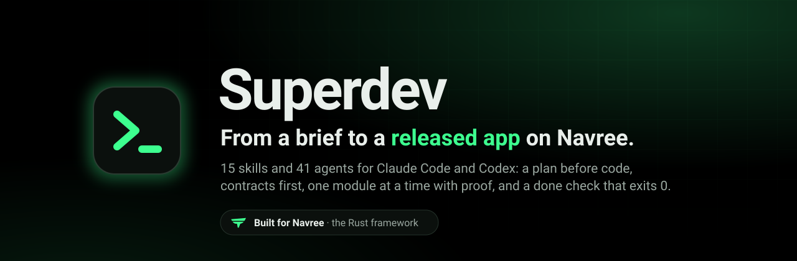
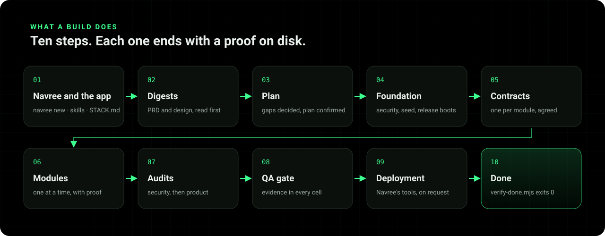

<p align="center">
  
</p>

<p align="center">
  <a href="https://boparaiamrit.github.io/superdev/"></a>
  <a href="https://navree.com"></a>
  
  
  <a href="LICENSE"></a>
</p>

<p align="center">
  <b>Give your agent a PRD and a design. Superdev builds the product on <a href="https://navree.com">Navree</a>,<br>
  and it doesn't call it done until the proof says so.</b><br>
  15 skills and 41 agents for Claude Code and Codex. A plan and contracts on disk before code, one module at a time,<br>
  proven in the running app and a real browser, then a security review, an audit, a QA gate and a done check that exits 0.
</p>

## Highlights

<table>
<tr>
<td width="50%" valign="top">

**Navree first**<br>
Every Navree app installs Navree's own skills with `navree skills:install`. Superdev never restates the framework: for each fact it names the Navree skill and the command, and keeps the part a framework can't, the way to ship.

</td>
<td width="50%" valign="top">

**A plan before code**<br>
The PRD and the design become digests, the open questions become `GAPS.md`, and `EXECUTION_PLAN.md` is confirmed by you before a line of code is written.

</td>
</tr>
<tr>
<td valign="top">

**Contracts first**<br>
Each module starts as `contracts/<module>.md`: models, validation, list specs and every route with its access rule. You agree it; it becomes the module's first commit.

</td>
<td valign="top">

**One module at a time, with proof**<br>
Backend, runtime proof, screens, browser proof, suites, commit. Then the next module. No parallel waves, no self-graded "looks done".

</td>
</tr>
<tr>
<td valign="top">

**Security built in**<br>
Sign-in, roles, personal data, money and live updates are laid at the foundation, each with what Navree provides, what the app adds and the committed test that proves it.

</td>
<td valign="top">

**A QA gate with evidence**<br>
Every route, role, width and colour mode on fresh data, written to `QA_COVERAGE.md` with evidence in every cell: contrast, dead links, money races, the phone app.

</td>
</tr>
<tr>
<td valign="top">

**Done means exit 0**<br>
`verify-done.mjs --suites --strict` runs Navree's checks, cargo, the release build and its health routes on the final commit. It passes, or the build isn't done.

</td>
<td valign="top">

**Every skill works alone**<br>
Ask for a security review, a QA pass or a stubborn bug, and that one skill runs. The full build only puts them in order.

</td>
</tr>
</table>

## Built on Navree

**[Navree](https://navree.com)** is the complete application framework for Rust. It gives every application one clear structure: modules wired by dependency injection and checked when the app boots. Auth, workspaces, an ORM, queues, search, real time and AI are in the box, and first-party tools take care of monitoring, admin and deployment.

Superdev builds on all of it. Screens are **Navree UI** pages drawn on the server, or a **Next.js** front end on the Navree API generated from its OpenAPI document; desktop and phone clients in **Tauri** are optional.

| Navree knows the framework | Superdev knows the process |
|:---|:---|
| Routing, the ORM, access, workspaces, queues, Navree UI and its tools, in skills kept in step with each release | The order of work, the files written to disk, the product rules and the proof each step needs |

[navree.com](https://navree.com) · [NavreeHQ/navree](https://github.com/NavreeHQ/navree) · [crates.io/crates/navree](https://crates.io/crates/navree)

## Get started

**1. Install it in your project.** Run these from the target Git project; Superdev is installed per project, never at user scope:

```shell
claude plugin marketplace add boparaiamrit/superdev --scope project
claude plugin install superdev@superdev --scope project
```

For an existing Navree app, the project is the app. For a new product, it's the Git folder that holds the PRD and the design; the build creates the app inside it. The helper `bash /path/to/superdev/install-superdev.sh` runs the same two commands and checks the result. Codex installs Superdev from the repository marketplace `.agents/plugins/marketplace.json` ([INSTALL.md](INSTALL.md), [CODEX.md](CODEX.md)).

**2. Start a build.** Give the agent the PRD and, if there is one, the design:

```text
Build this product on Navree. The PRD is docs/prd.md and the design is in docs/design/.
```

**Or ask for just one thing.** Every skill runs on its own:

| Want only... | Say... | What runs |
|:---|:---|:---|
| A security review | *"Run a security review of this app"* | `security-review-and-fix` |
| The truth about "done" | *"Is this really wired up, or does it only look done?"* | `product-audit` |
| Everything tested | *"Check every page, every role, contrast, dead links, the app"* | `product-qa` |
| A stubborn bug fixed properly | *"Help me debug this failure: ..."* | `systematic-debugging` |
| Screens from a design | *"Turn this design into Navree UI screens"* | `design-to-navree-ui` |
| A Next.js front end | *"Build the web app in Next.js on the Navree API"* | `design-to-nextjs` |
| A phone or desktop app | *"Build the Android and iOS app on the same API"* | `design-to-tauri` |
| A prototype made real | *"Turn this prototype into a Navree app without changing what users see"* | `prototype-to-navree` |
| A yes or no on done | *"Are we done?"* | `superdev-done` |

> 3.0.0 is the first release of Superdev on Navree. Its 142 tests run on Linux and Windows for every change; the first full app built end to end with it is under way.

## How a build works

<p align="center">
  
</p>

The [superdev-build](plugins/superdev/skills/superdev-build/SKILL.md) skill runs the steps in order, and each one leaves its proof on disk: `STACK.md`, `PRD_DIGEST.md`, `DESIGN_DIGEST.md`, `GAPS.md`, `EXECUTION_PLAN.md`, `contracts/`, `QA_COVERAGE.md`. The build's memory lives in the repository, not in the chat.

## The 15 skills

| Skill | Use it when |
|:---|:---|
| [**superdev-build**](plugins/superdev/skills/superdev-build/SKILL.md) | building a product from a PRD and a design as a Navree app, or resuming such a build |
| [**backend-on-navree**](plugins/superdev/skills/backend-on-navree/SKILL.md) | building a backend module: models, routes, validation, access, workspace scope, lists, jobs, mail, audit, seed data |
| [**security-foundation**](plugins/superdev/skills/security-foundation/SKILL.md) | the app has sign-in, staff, roles, personal data, money or live updates |
| [**design-to-navree-ui**](plugins/superdev/skills/design-to-navree-ui/SKILL.md) | a design must become Navree UI screens |
| [**design-to-nextjs**](plugins/superdev/skills/design-to-nextjs/SKILL.md) | a design must become a Next.js front end of a Navree API |
| [**frontend-structure**](plugins/superdev/skills/frontend-structure/SKILL.md) | laying out, auditing or splitting a module of a Next.js front end |
| [**prototype-to-navree**](plugins/superdev/skills/prototype-to-navree/SKILL.md) | a prototype or an older product must become a Navree app without losing what its users see |
| [**design-preservation**](plugins/superdev/skills/design-preservation/SKILL.md) | a prototype must be kept as built and every screen checked against it |
| [**design-to-tauri**](plugins/superdev/skills/design-to-tauri/SKILL.md) | the product needs a desktop or phone client in Tauri on its Navree API |
| [**security-review-and-fix**](plugins/superdev/skills/security-review-and-fix/SKILL.md) | before launch, after a large change, a secret scan, a dependency audit |
| [**product-audit**](plugins/superdev/skills/product-audit/SKILL.md) | someone needs to know whether the product is really done: real data, wired controls, readiness |
| [**product-qa**](plugins/superdev/skills/product-qa/SKILL.md) | every page, every role, contrast, dead links, the phone app; or exploring the running app |
| [**systematic-debugging**](plugins/superdev/skills/systematic-debugging/SKILL.md) | anything fails: a test, a build, a runtime error, a flaky test |
| [**superdev-done**](plugins/superdev/skills/superdev-done/SKILL.md) | someone asks whether the build is done, and before any claim that it is |
| [**superdev-self-learning**](plugins/superdev/skills/superdev-self-learning/SKILL.md) | you correct the approach, a verifier rejects work, or someone says remember this |

<details>
<summary><b>The 41 agents</b>, dispatched one module or one task at a time</summary>

<br>

- **Planning:** `prd-analyst`, `design-inventory`, `gap-auditor`, `plan-architect`
- **Building:** `navree-app-bootstrapper`, `navree-module-builder`, `navree-ui-screen-builder`, `nextjs-module-builder`, `seed-data-architect`
- **Prototypes and refactors:** `codebase-discoverer`, `schema-reverse-engineer`, `migration-planner`, `refactor-planner`, `visual-diff-auditor`
- **Security review:** `repo-cartographer`, `static-auditor`, `dynamic-auditor`, `dependency-auditor`
- **Audit:** `placeholder-hunter`, `data-source-auditor`, `journey-walker`, `tenancy-isolation-tester`, `module-readiness-rater`, `module-structure-auditor`, `ui-auditor`
- **QA:** `qa-environment`, `qa-flow-tester`, `qa-consistency-checker`, `qa-performance-prober`, `link-crawler`, `a11y-contrast-auditor`, `role-matrix-tester`, `money-integrity-prober`, `realtime-prober`, `mobile-qa-tester`
- **Debugging and fixing:** `bug-reproducer`, `root-cause-investigator`, `hypothesis-tester`, `regression-verifier`, `fix-applier`
- **Lessons:** `lesson-writer`

Each agent file says what it reads, what it writes and what it returns: [plugins/superdev/README.md](plugins/superdev/README.md).

</details>

<details>
<summary><b>The 25 hard rules</b>, each with where it applies and the check that proves it</summary>

<br>

**Before code**

1. Install the Navree CLI, create the app and install Navree's skills first
2. Confirm the plan on disk before code
3. Agree each module's contract before its code; one owner

**Every module**

4. Boot the release binary after each backend module
5. A declaration is not proof

**Navree traps**

6. Declare access on every route
7. Write inside the request's unit of work; make jobs safe to run twice
8. Validation errors are 400; only Navree UI forms answer 422
9. Keep secrets in `.env` or the environment, and know which source wins
10. Models are global until marked for a workspace
11. SQLite and MySQL have no row-level security
12. Register the audit module; the minimal app does not
13. Give `navree check` its configuration and a migrated database
14. Fill a gap in Navree UI the Navree way, never with raw markup
15. Fix the cause; add no suppression
16. Never edit a shipped migration; set the production defaults
17. Never edit regenerated files by hand

**Product, security and clients**

18. Prove every screen in a real browser
19. Give operators structured controls
20. Use one canonical public origin
21. End access the way each client signs in
22. Serialize balance changes per account
23. Make money-moving and record-creating requests idempotent
24. Publish live updates only after the commit
25. Prove native clients on a device

Read them in full in [hard-rules.md](plugins/superdev/skills/superdev-build/references/hard-rules.md).

</details>

## Requirements

- **Navree:** the CLI (`cargo install navree-cli`), Rust 1.95 or newer, a C compiler (gcc or clang; on Windows the MSVC build tools), and Docker or Podman for a local TimescaleDB or PostgreSQL database (MySQL runs on a server you provide; SQLite needs nothing)
- **Node.js 22 or newer**, only for a Next.js front end and the browser tools of the QA agents
- **Claude Code or Codex**

## Repository

```text
plugins/superdev/      the plugin: skills/, agents/, scripts/verify-done.mjs and both manifests
.claude-plugin/        the Claude Code marketplace
.agents/plugins/       the Codex marketplace
docs/                  the website, boparaiamrit.github.io/superdev
tests/                 the repository's tests
tools/build_zip.py     builds superdev.zip, the archive attached to each release
```

```bash
python -m unittest discover -s tests -v   # needs Python 3.9+ and node
python tools/build_zip.py                 # --check compares it with the committed archive
```

Older projects: version 2.1.0, for NestJS and Laravel, stays available under the tag `v2.1.0`; [INSTALL.md](INSTALL.md) shows how to pin a project to it.

## Author

Superdev is made by **Amritpal Singh**, founder of [Navree](https://navree.com): a serial entrepreneur and full-stack developer with fifteen years of building software, six startups and more than a hundred open-source packages. Navree holds what those years taught him, and Superdev is the way he ships products on it.

- Email: [boparaiamrit@gmail.com](mailto:boparaiamrit@gmail.com)
- GitHub: [@boparaiamrit](https://github.com/boparaiamrit)
- Also by Amritpal Singh: [Skiff](https://boparaiamrit.github.io/skiff/), Claude Code in your pocket, part of Navree

## License

MIT; see [LICENSE](LICENSE).

<p align="center">
  <sub>Built by <a href="https://github.com/boparaiamrit">Amritpal Singh</a> (<a href="mailto:boparaiamrit@gmail.com">boparaiamrit@gmail.com</a>) · founder of <a href="https://navree.com">Navree</a> · <a href="https://boparaiamrit.github.io/superdev/">boparaiamrit.github.io/superdev</a></sub>
</p>
